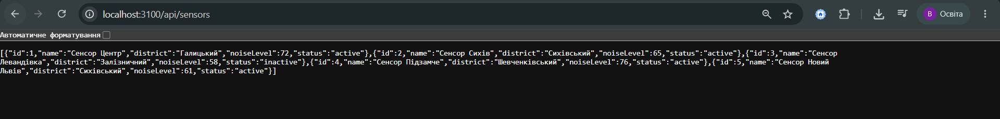
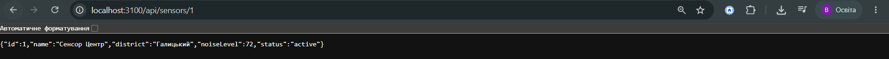
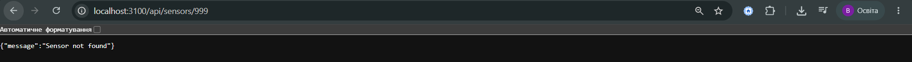
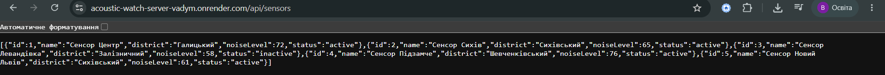
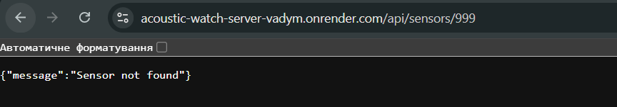
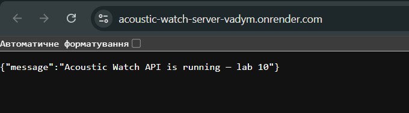

# Звіт з лабораторної роботи №10

**Дисципліна:** Веб-програмування  
**Тема:** Створення серверного застосунку на Node.js  

## Мета роботи

Навчитися створювати серверний застосунок на Node.js та Express, обробляти GET-запити, повертати JSON і HTTP-коди стану, запускати сервер локально та розгортати його на Render. Перевірити оновлення публічного сервера після завантаження змін на GitHub.

## Хід роботи

### 1. Підготовка серверного проєкту

У наявному репозиторії `Web_Programming` створено окрему папку `lab/lab10` для Node.js-проєкту `acoustic-watch-server`. Встановлено Express. У `package.json` задано `"type": "module"`, що дозволяє використовувати синтаксис `import` та `export`.

Передбачено такі команди:

```bash
npm install
npm start
npm run dev
```

`npm start` запускає `node src/server.js`, а `npm run dev` — `node --watch src/server.js`. Режим watch автоматично перезапускає сервер після зміни файлів.

| Файл | Призначення |
| --- | --- |
| `src/server.js` | Express-застосунок, маршрути та запуск сервера |
| `src/data/sensors.js` | Початкові дані датчиків |
| `package.json` | Опис проєкту, залежності й команди |
| `package-lock.json` | Точні версії залежностей |
| `.gitignore` | Виключення node_modules, .env і логів із Git |

### 2. Підготовка даних

У файлі `src/data/sensors.js` створено та експортовано масив із п’яти датчиків. Кожен об’єкт містить поля `id`, `name`, `district`, `noiseLevel` і `status`.

| ID | Назва | Район | Шум | Статус |
| --- | --- | --- | --- | --- |
| 1 | Сенсор Центр | Галицький | 72 дБ | active |
| 2 | Сенсор Сихів | Сихівський | 65 дБ | active |
| 3 | Сенсор Левандівка | Залізничний | 58 дБ | inactive |
| 4 | Сенсор Підзамче | Шевченківський | 76 дБ | active |
| 5 | Сенсор Новий Львів | Сихівський | 61 дБ | active |

На цьому етапі джерелом даних є масив у JavaScript-файлі. База даних не використовується.

### 3. Створення Express-сервера

У `src/server.js` підключено Express і масив датчиків:

```javascript
import express from 'express';
import sensors from './data/sensors.js';

const app = express();
const PORT = process.env.PORT || 3000;

app.use(express.json());
```

Сервер слухає порт зі змінної середовища `PORT` на адресі `0.0.0.0`. Якщо змінну не задано, використовується порт 3000. На Render потрібний порт надає платформа.

### 4. Реалізація основних маршрутів

Створено три основні GET-маршрути:

| Маршрут | Призначення |
| --- | --- |
| `/` | Повідомлення про роботу API |
| `/api/sensors` | Масив усіх датчиків |
| `/api/sensors/:id` | Один датчик за ідентифікатором |

Пошук датчика за ID реалізовано так:

```javascript
app.get('/api/sensors/:id', (req, res) => {
  const sensorId = Number(req.params.id);
  const sensor = sensors.find((item) => item.id === sensorId);

  if (!sensor) {
    return res.status(404).json({ message: 'Sensor not found' });
  }

  res.json(sensor);
});
```

Параметр `req.params.id` надходить як рядок, тому перед порівнянням із числовим полем `id` використано `Number()`.

За успішного виконання повертається код 200. Якщо датчик не знайдено — код 404. Для неочікуваних помилок передбачено обробник із кодом 500 та JSON-повідомленням `Internal server error`.

### 5. Локальна перевірка API

Порт 3000 був зайнятий VS Code Live Preview зі сторінкою звітів, тому для Express використано порт **3100** через змінну середовища `PORT`.

Базова локальна адреса API:

[http://localhost:3100/](http://localhost:3100/)

За адресою `/api/sensors` отримано масив із п’яти датчиків.

Локальне отримання всіх датчиків

*Рисунок 1 — Відповідь GET /api/sensors на локальному сервері.*

За адресою `/api/sensors/1` отримано об’єкт «Сенсор Центр» із рівнем шуму 72 дБ.

Локальне отримання датчика за ID!

*Рисунок 2 — Відповідь GET /api/sensors/1.*

Для перевірки відсутнього ресурсу виконано запит `/api/sensors/999`. Сервер повертає код 404 і повідомлення:

```json
{"message":"Sensor not found"}
```

Повідомлення про відсутній датчик

*Рисунок 3 — JSON-відповідь для невідомого ID 999.*

### 6. Самостійні маршрути

Для самостійної частини обрано та реалізовано два додаткові маршрути:

| Маршрут | Результат для початкових даних |
| --- | --- |
| `/api/sensors/active` | Чотири активні датчики: ID 1, 2, 4, 5 |
| `/api/sensors/district/Сихівський` | Два датчики: ID 2 і 5 |

Активні датчики відбираються за допомогою `filter()` і перевірки поля `status`.

У маршруті району використано `req.params.district`; порівняння виконується без урахування регістру. Якщо збігів немає, повертається порожній масив.

Статичний маршрут `/api/sensors/active` оголошено перед `/api/sensors/:id`, щоб слово `active` не сприймалося як ідентифікатор датчика.

Реалізацію перевірено локально реальними HTTP-запитами: основні й додаткові маршрути, невідомі ID, обробку некоректних запитів і серверних помилок. Загалом виконано 24 перевірки.

### 7. Розгортання на Render

Серверний проєкт завантажено в підпапку наявного GitHub-репозиторію. На Render створено Web Service для сервера `acoustic-watch-server-vadym`.

Для проєкту підготовлено такі налаштування розгортання:

| Параметр | Значення |
| --- | --- |
| Репозиторій | vrekunov2023/Web_Programming |
| Гілка | main |
| Runtime | Node |
| Root Directory | lab/lab10 |
| Build Command | npm ci |
| Start Command | npm start |
| Compute Plan | Free |

Після deployment сервер отримав публічну адресу:

[https://acoustic-watch-server-vadym.onrender.com/](https://acoustic-watch-server-vadym.onrender.com/)

Головний маршрут повернув повідомлення про успішну роботу API.


*Рисунок 4 — Перший успішний запуск сервера на Render.*

### 8. Перевірка публічного API

Перевірено отримання всіх датчиків за публічною адресою:

[GET /api/sensors](https://acoustic-watch-server-vadym.onrender.com/api/sensors)

Список датчиків на Render

*Рисунок 5 — Отримання п’яти датчиків через публічний API.*

Також перевірено обробку невідомого ID:

[GET /api/sensors/999](https://acoustic-watch-server-vadym.onrender.com/api/sensors/999)

Відсутній датчик на Render

*Рисунок 6 — Повідомлення Sensor not found у публічному API.*

### 9. Оновлення застосунку

Для перевірки повторного deployment змінено повідомлення головного маршруту:

```javascript
app.get('/', (req, res) => {
  res.json({ message: 'Acoustic Watch API is running — lab 10' });
});
```

Зміни збережено в Git та завантажено на GitHub. Після повторного deployment головний маршрут на Render повернув нове повідомлення з позначкою `lab 10`.

Оновлене повідомлення після deployment

*Рисунок 7 — Публічний сервер після оновлення коду.*

## Відповіді на контрольні питання

**1. Для чого Node.js потрібний у цій лабораторній роботі?**  
Node.js виконує JavaScript поза браузером. У цій роботі він запускає сервер, який приймає HTTP-запити та повертає дані датчиків.

**2. Що спрощує Express у порівнянні зі створенням HTTP-сервера вручну?**  
Express спрощує опис маршрутів, роботу із запитами, надсилання JSON-відповідей, установлення HTTP-кодів і підключення проміжних обробників.

**3. Що таке маршрут і з яких двох частин його зручно описувати?**  
Маршрут визначає обробку запиту за HTTP-методом і шляхом. Наприклад, `GET /api/sensors`: GET — метод, а /api/sensors — шлях.

**4. Для чого потрібний package.json?**  
Містить опис Node.js-проєкту, його залежності, npm-скрипти та налаштування, зокрема тип модулів.

**5. Яка різниця між npm start та npm run dev у нашому проєкті?**  
`npm start` виконує звичайний запуск `node src/server.js`. `npm run dev` запускає `node --watch src/server.js`, тому сервер перезапускається після зміни файлів.

**6. Що означає HTTP-код 404 у маршруті /api/sensors/:id?**  
Датчика з переданим ідентифікатором не знайдено. Сервер повертає повідомлення `Sensor not found`.

**7. Навіщо використовувати process.env.PORT, а не тільки число 3000?**  
Хостинг може призначати серверу власний порт. Змінна `process.env.PORT` дозволяє отримати його із середовища, а 3000 використовується як локальне значення за замовчуванням.

**8. Чим localhost відрізняється від URL сервера на Render?**  
`localhost` указує на поточний комп’ютер. Публічна адреса Render дозволяє звертатися до розгорнутого сервера через Інтернет.

**9. Що відбувається після git push у гілку main, якщо на Render увімкнений Auto-Deploy?**  
Render отримує зміни з підключеної гілки та запускає нову збірку й deployment. Після успішного завершення за публічною адресою працює оновлена версія.

## Висновок

Створено Node.js/Express-сервер для проєкту «Акустична варта». Реалізовано отримання всіх датчиків і одного датчика за ID, обробку помилки 404, а також додаткові маршрути активних датчиків і вибраного району.

Сервер перевірено локально, розгорнуто на Render і перевірено через публічний URL. Оновлення повідомлення після повторного deployment підтвердило застосування змін із GitHub.