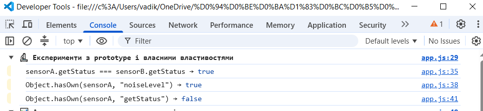
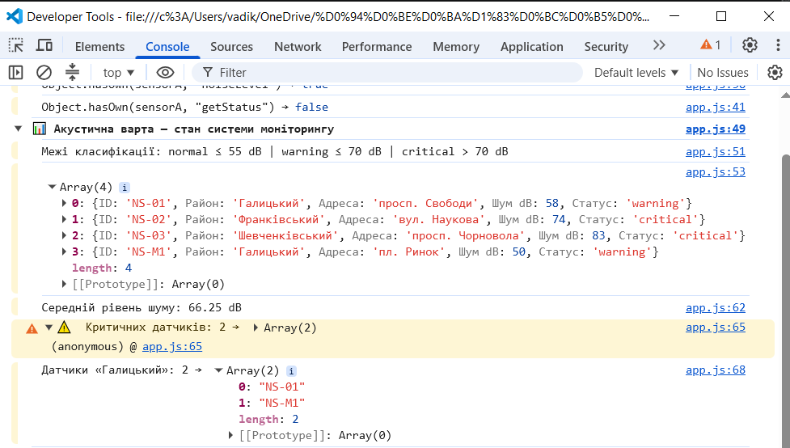
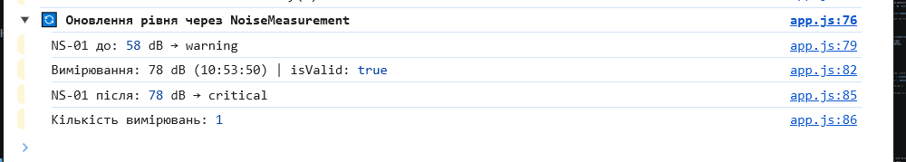
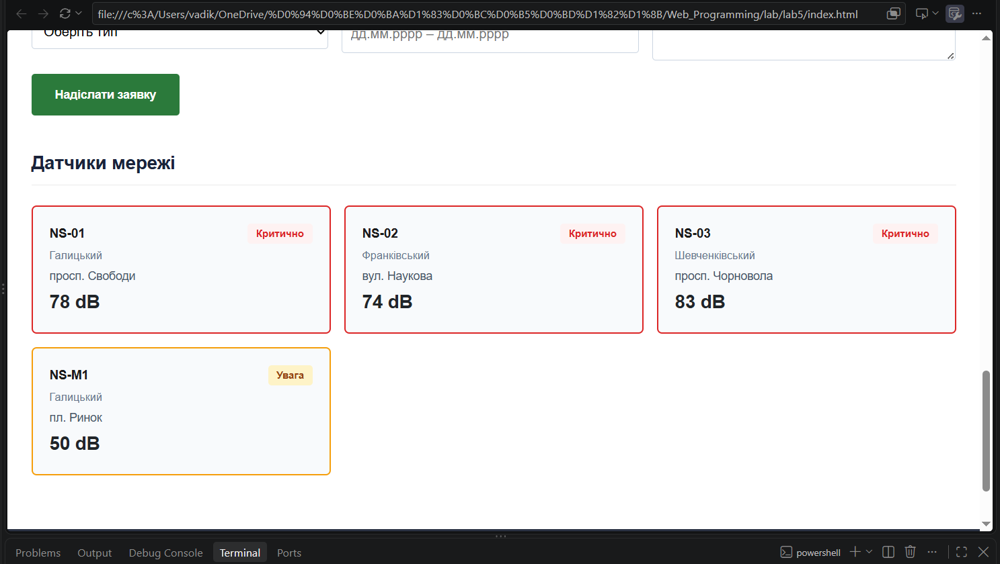

# Звіт з лабораторної роботи №5

**Тема:** «Проєктування системи класів у JavaScript»
---

## 1. Мета

Навчитися переходити від окремих функцій до спроєктованої системи взаємопов'язаних класів: виділяти сутності предметної області, визначати їх стан і поведінку, розподіляти відповідальності, будувати композицію та наслідування, інтегрувати об'єктну модель у наявний вебпроєкт «Акустична варта».

---

## 2. Завдання

- Виділити сутності предметної області та спроєктувати таблицю класів.
- Реалізувати класи `NoiseSensor`, `NoiseMeasurement`, `MonitoringSystem` та `MobileNoiseSensor`.
- Централізувати бізнес-правила класифікації шуму в одному місці.
- Реалізувати щонайменше один `static`-метод.
- Продемонструвати різницю між власними властивостями екземпляра та методами з `prototype`.
- Інтегрувати систему зі сторінкою: відрендерити картки датчиків за даними екземплярів.

---

## 3. Проєктування системи класів

### 3.1. Таблиця відповідальностей

| Клас | Що моделює | Основні властивості | Основні методи | З чим взаємодіє |
| --- | --- | --- | --- | --- |
| `NoiseSensor` | Фізичний датчик у точці міста | `id`, `district`, `location`, `noiseLevel`, `measurements` | `getStatus()`, `updateNoiseLevel()`, `addMeasurement()`, `static isValidNoiseLevel()`, `static fromObject()` | `NoiseMeasurement`, `MonitoringSystem` |
| `NoiseMeasurement` | Одне вимірювання в певний момент | `value`, `measuredAt` | `isValid()`, `toString()` | `NoiseSensor` |
| `MonitoringSystem` | Колекція датчиків системи | `sensors` | `addSensor()`, `findSensorById()`, `getSensorsByDistrict()`, `getCriticalSensors()`, `getAverageNoiseLevel()` | `NoiseSensor` |
| `MobileNoiseSensor` | Мобільний різновид датчика | успадковує + `batteryLevel` | успадковує + `needsCharging()`, перевизначає `getStatus()` | успадковує від `NoiseSensor` |

### 3.2. Схема зв'язків

```
MonitoringSystem
  └── sensors[]  ──────────────► NoiseSensor
                                   └── measurements[]  ──► NoiseMeasurement

MobileNoiseSensor  extends  NoiseSensor
```

`MonitoringSystem` та `NoiseSensor` пов'язані **композицією**: система містить масив екземплярів датчиків. `MobileNoiseSensor` та `NoiseSensor` пов'язані **наслідуванням**: мобільний датчик є різновидом звичайного.

---

## 4. Структура файлів

```
acoustic-watch/
├── index.html
├── css/main.css
├── scss/
└── js/
    ├── models/
    │   ├── NoiseSensor.js         ← клас датчика + NOISE_LIMITS
    │   ├── NoiseMeasurement.js    ← клас вимірювання
    │   └── MobileNoiseSensor.js   ← підклас (extends)
    ├── services/
    │   └── MonitoringSystem.js    ← колекція датчиків
    └── app.js                     ← ініціалізація + рендеринг
```

Підключення в `index.html` через `type="module"`:

```html
<script type="module" src="./js/app.js"></script>
```

`type="module"` дає можливість використовувати `import`/`export` між файлами і автоматично відкладає виконання після розбору HTML (як `defer`). Запуск обов'язково через Live Server, а не відкриттям файлу напряму.

---

## 5. Реалізація

### 5.1. Централізовані межі класифікації

```js
export const NOISE_LIMITS = Object.freeze({
  normalMax:  55,
  warningMax: 70,
});
```

`Object.freeze` забороняє змінювати об'єкт. Числа `55` і `70` записані лише тут — жоден метод не дублює їх вручну.

### 5.2. Клас `NoiseSensor`

```js
export class NoiseSensor {
  constructor(id, district, location, noiseLevel) {
    this.id           = id;
    this.district     = district;
    this.location     = location;
    this.noiseLevel   = noiseLevel;
    this.measurements = [];
  }

  getStatus() {
    if (this.noiseLevel <= NOISE_LIMITS.normalMax)  return 'normal';
    if (this.noiseLevel <= NOISE_LIMITS.warningMax) return 'warning';
    return 'critical';
  }

  updateNoiseLevel(value) {
    if (!NoiseSensor.isValidNoiseLevel(value)) {
      throw new Error(`Некоректний рівень шуму: ${value}`);
    }
    this.noiseLevel = value;
  }

  addMeasurement(measurement) {
    this.measurements.push(measurement);
    this.updateNoiseLevel(measurement.value);
  }

  static isValidNoiseLevel(value) {
    return Number.isFinite(value) && value >= 0 && value <= 200;
  }

  static fromObject(data) {
    return new NoiseSensor(data.id, data.district, data.location, data.noiseLevel ?? 0);
  }
}
```

**Чому `isValidNoiseLevel` — static:** перевірка числа не залежить від стану конкретного датчика. Її можна викликати без екземпляра: `NoiseSensor.isValidNoiseLevel(74)`.

**Чому `fromObject` — static:** це фабричний метод. Він отримує plain object і повертає новий екземпляр. Немає сенсу викликати його через існуючий об'єкт.

### 5.3. Клас `NoiseMeasurement`

```js
export class NoiseMeasurement {
  constructor(value) {
    this.value      = value;
    this.measuredAt = new Date();
  }

  isValid() {
    return Number.isFinite(this.value) && this.value >= 0 && this.value <= 200;
  }

  toString() {
    return `${this.value} dB (${this.measuredAt.toLocaleTimeString('uk-UA')})`;
  }
}
```

### 5.4. Клас `MonitoringSystem`

```js
export class MonitoringSystem {
  constructor() {
    this.sensors = [];
  }

  addSensor(sensor) {
    if (!(sensor instanceof NoiseSensor)) {
      throw new Error("Можна додавати лише об'єкти NoiseSensor");
    }
    if (this.sensors.some(s => s.id === sensor.id)) {
      throw new Error(`Датчик ${sensor.id} вже існує`);
    }
    this.sensors.push(sensor);
  }

  findSensorById(id)          { return this.sensors.find(s => s.id === id) ?? null; }
  getSensorsByDistrict(d)     { return this.sensors.filter(s => s.district === d); }
  getCriticalSensors()        { return this.sensors.filter(s => s.getStatus() === 'critical'); }

  getAverageNoiseLevel() {
    if (this.sensors.length === 0) return null;
    const sum = this.sensors.reduce((acc, s) => acc + s.noiseLevel, 0);
    return sum / this.sensors.length;
  }
}
```

`getCriticalSensors` викликає `sensor.getStatus()` — правила 55/70 не дублюються.  
`getAverageNoiseLevel` повертає `null` для порожньої колекції.

### 5.5. Наслідування — `MobileNoiseSensor`

```js
export class MobileNoiseSensor extends NoiseSensor {
  constructor(id, district, location, noiseLevel, batteryLevel) {
    super(id, district, location, noiseLevel);
    this.batteryLevel = batteryLevel;
  }

  needsCharging() { return this.batteryLevel < 20; }

  getStatus() {
    const base = super.getStatus();
    if (this.needsCharging() && base === 'normal') return 'warning';
    return base;
  }
}
```

`super(...)` викликає `constructor` батьківського класу та ініціалізує успадкований стан. До `this` не можна звертатися до виклику `super()`. `MobileNoiseSensor` є різновидом `NoiseSensor` — відношення «є різновидом» тут справді виконується.

---

## 6. Ініціалізація та рендеринг

```js
const sensorsData = [
  { id: 'NS-01', district: 'Галицький',      location: 'просп. Свободи',   noiseLevel: 58 },
  { id: 'NS-02', district: 'Франківський',   location: 'вул. Наукова',     noiseLevel: 74 },
  { id: 'NS-03', district: 'Шевченківський', location: 'просп. Чорновола', noiseLevel: 83 },
];

const system = new MonitoringSystem();
sensorsData.map(NoiseSensor.fromObject).forEach(s => system.addSensor(s));

const mobile = new MobileNoiseSensor('NS-M1', 'Галицький', 'пл. Ринок', 50, 15);
system.addSensor(mobile);
```

Plain objects перетворюються на екземпляри через `NoiseSensor.fromObject` — статичний фабричний метод. Мобільний датчик додається окремо.

`renderSensorCard` — окрема функція, а не метод `NoiseSensor`, бо створення DOM-елемента не є поведінкою фізичного датчика:

```js
function renderSensorCard(sensor) {
  const status = sensor.getStatus();
  const card   = document.createElement('article');
  card.className = `sensor-card sensor-card--${status}`;
  card.innerHTML = `
    <div class="sensor-card__header">
      <span class="sensor-card__id">${sensor.id}</span>
      <span class="sensor-card__badge sensor-card__badge--${status}">${statusLabel(status)}</span>
    </div>
    <div class="sensor-card__district">${sensor.district}</div>
    <div class="sensor-card__location">${sensor.location}</div>
    <div class="sensor-card__level">${sensor.noiseLevel} dB</div>
  `;
  return card;
}
```

---

## 7. Консольні експерименти

### 7.1. Prototype і власні властивості

Перед запуском записано прогноз для кожного виразу:

| Вираз | Прогноз | Результат | Пояснення |
| --- | --- | --- | --- |
| `sensorA.getStatus === sensorB.getStatus` | `true` | `true` | Метод знаходиться в `NoiseSensor.prototype`, а не копіюється в кожен екземпляр |
| `Object.hasOwn(sensorA, 'noiseLevel')` | `true` | `true` | `noiseLevel` записується в `constructor` через `this` — це власна властивість екземпляра |
| `Object.hasOwn(sensorA, 'getStatus')` | `false` | `false` | `getStatus` — не власна властивість; екземпляр знаходить її через прототипний ланцюжок |



### 7.2. Звіт системи в Console



### 7.3. Оновлення рівня через `addMeasurement`

```
NS-01 до:    58 dB → warning
Вимірювання: 78 dB | isValid: true
NS-01 після: 78 dB → critical
```



---

## 8. Результати

### Контрольні значення (за методичкою)

| Датчик | Рівень | Очікуваний статус | Результат |
| --- | --- | --- | --- |
| NS-01 | 58 dB | warning | ✅ warning |
| NS-02 | 74 dB | critical | ✅ critical |
| NS-03 | 83 dB | critical | ✅ critical |
| NS-M1 | 50 dB, батарея 15% | warning | ✅ warning |

Середній рівень: **71.67 dB** (збігається з методичкою).

### Сторінка з картками датчиків



---

## 9. Відповіді на контрольні питання

**Чим клас відрізняється від екземпляра?**
Клас — опис структури і поведінки. Екземпляр — конкретний об'єкт із власним станом, створений через `new`.

**Чому `noiseLevel` є власною властивістю, а `getStatus` — ні?**
`noiseLevel` записується в `constructor` через `this` і належить конкретному екземпляру. `getStatus` оголошений у тілі `class` і розміщується в `NoiseSensor.prototype` — спільний для всіх екземплярів.

**Коли доцільний `static`-метод?**
Коли операція логічно пов'язана з типом, але не потребує стану конкретного екземпляра. `isValidNoiseLevel(74)` перевіряє число, а не датчик — тому `static`.

**Чим композиція відрізняється від наслідування?**
Композиція: один об'єкт містить інший (`MonitoringSystem` містить масив `NoiseSensor`). Наслідування: один клас є різновидом іншого (`MobileNoiseSensor extends NoiseSensor`). Перевірка наслідування — речення «є різновидом»: мобільний датчик справді є різновидом датчика.

**Для чого `super()` у похідному класі?**
Викликає `constructor` батьківського класу і ініціалізує успадкований стан. До `this` не можна звертатися до виклику `super()`.

**Чому `renderSensorCard` не є методом `NoiseSensor`?**
Створення DOM-елемента — логіка інтерфейсу, а не поведінка фізичного датчика. Змішування призвело б до залежності моделі від браузерного API.

---

## 10. Висновки

У роботі реалізовано систему з чотирьох класів для проєкту «Акустична варта». `NoiseSensor` інкапсулює стан і поведінку датчика; `NoiseMeasurement` моделює окреме вимірювання; `MonitoringSystem` управляє колекцією через `filter`, `find` і `reduce`; `MobileNoiseSensor` демонструє наслідування. Межі класифікації централізовані в `NOISE_LIMITS` і не дублюються. Відокремлення моделі від DOM-коду дозволило тестувати логіку класів у Console незалежно від сторінки. Файли розділені за відповідальністю та пов'язані через ES-модулі (`import`/`export`).