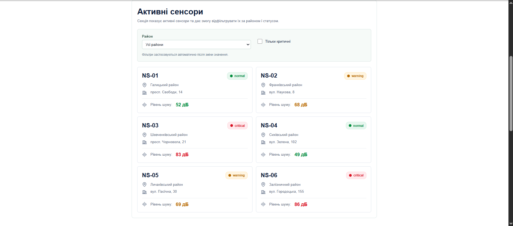

# Звіт з лабораторної роботи №6

**Тема:** Відображення та фільтрація сенсорів у DOM


## 1. Мета роботи

Навчитися відображати дані сенсорів на сторінці «Акустична варта» засобами JavaScript та фільтрувати їх за районом і статусом. Закріпити використання `querySelector()`, `createElement()`, `textContent`, `classList`, `append()`, `replaceChildren()`, методу масиву `filter()` та обробників події `change`.

## 2. Завдання

- Продовжити вебпроєкт із лабораторної роботи №5.
- Після блоку «Поточний моніторинг» додати секцію «Активні сенсори».
- Розмістити список районів, checkbox «Тільки критичні» та контейнер карток.
- Створювати картки сенсорів за даними JavaScript.
- По-різному оформити статуси `normal`, `warning` та `critical`.
- Реалізувати одночасну фільтрацію за районом і критичним статусом.
- За відсутності збігів залишати список порожнім.

## 3. Структура проєкту

| Файл | Призначення |
| --- | --- |
| `index.html` | Сторінка з новою секцією, фільтрами та контейнером `.sensor-list` |
| `js/app.js` | Початкові дані, створення карток, відображення та фільтрація |
| `js/models/NoiseSensor.js` | Клас сенсора та визначення статусу з лабораторної №5 |
| `js/services/MonitoringSystem.js` | Колекція об’єктів сенсорів із лабораторної №5 |
| `scss/_active-sensors.scss` | Оформлення нової секції та адаптивної сітки |
| `scss/main.scss` | Підключення SCSS-модулів |
| `css/main.css` | Готові стилі сторінки |

Скрипт підключений як модуль:

```html
<script type="module" src="./js/app.js"></script>
```

Модуль виконується після розбору HTML, тому елементи секції доступні під час виклику `querySelector()`. Для запуску сторінки використовується локальний HTTP-сервер, наприклад Live Server.

## 4. Хід роботи

### 4.1. Додавання секції в HTML

Після секції «Поточний моніторинг» додано заголовок, пояснення, фільтри та порожній контейнер. У списку доступні всі шість районів, представлених у даних.

Основні елементи розмітки:

```html
<section class="container section active-sensors"
         aria-labelledby="active-sensors-title">
  <h2 id="active-sensors-title">Активні сенсори</h2>

  <div class="sensor-filters">
    <label for="district-filter">
      Район
      <select id="district-filter">
        <option value="all">Усі райони</option>
        <option value="Галицький">Галицький</option>
        <option value="Франківський">Франківський</option>
        <option value="Шевченківський">Шевченківський</option>
        <option value="Сихівський">Сихівський</option>
        <option value="Личаківський">Личаківський</option>
        <option value="Залізничний">Залізничний</option>
      </select>
    </label>

    <label for="critical-filter">
      <input type="checkbox" id="critical-filter">
      Тільки критичні
    </label>
  </div>

  <div class="sensor-list" aria-live="polite"></div>
</section>
```

Картки не записані в HTML вручну: вони створюються під час виконання JavaScript.

### 4.2. Підготовка даних

Підготовлено шість сенсорів із різними районами, адресами та рівнями шуму:

```js
const sensorsData = [
  {
    id: 'NS-01',
    district: 'Галицький',
    location: 'просп. Свободи, 14',
    noiseLevel: 52
  },
  {
    id: 'NS-02',
    district: 'Франківський',
    location: 'вул. Наукова, 8',
    noiseLevel: 68
  },
  {
    id: 'NS-03',
    district: 'Шевченківський',
    location: 'просп. Чорновола, 21',
    noiseLevel: 83
  },
  {
    id: 'NS-04',
    district: 'Сихівський',
    location: 'вул. Зелена, 102',
    noiseLevel: 49
  },
  {
    id: 'NS-05',
    district: 'Личаківський',
    location: 'вул. Пасічна, 30',
    noiseLevel: 69
  },
  {
    id: 'NS-06',
    district: 'Залізничний',
    location: 'вул. Городоцька, 155',
    noiseLevel: 86
  }
];
```

Для продовження попередньої роботи використано наявні класи `NoiseSensor` і `MonitoringSystem`:

```js
import { NoiseSensor } from './models/NoiseSensor.js';
import { MonitoringSystem } from './services/MonitoringSystem.js';

const system = new MonitoringSystem();

sensorsData.map(NoiseSensor.fromObject)
  .forEach(sensor => system.addSensor(sensor));

const sensors = system.sensors;
```

Метод `NoiseSensor.fromObject()` перетворює звичайний об’єкт із масиву даних на екземпляр класу.

Статус отримується через `sensor.getStatus()` за навчальними порогами попередньої лабораторної:

- `normal` — до 55 дБ включно;
- `warning` — понад 55 і до 70 дБ включно;
- `critical` — понад 70 дБ.

Ці правила не дублюються в коді фільтрів.

### 4.3. Пошук DOM-елементів

Через `querySelector()` отримано посилання на контейнер і два фільтри:

```js
const sensorList = document.querySelector('.sensor-list');
const districtFilter = document.querySelector('#district-filter');
const criticalFilter = document.querySelector('#critical-filter');
```

Селектор із крапкою знаходить елемент за класом, а селектор із символом `#` — за ідентифікатором.

### 4.4. Створення картки сенсора

Функція `createSensorCard(sensor)` отримує один сенсор і повертає елемент `article`. До картки додаються класи `sensor-card` та клас відповідного статусу:

```js
const status = sensor.getStatus();

const card = document.createElement('article');
card.classList.add('sensor-card', `sensor-card--${status}`);
```

Усередині картки створюються заголовок з ID, позначка статусу, район, локація та рівень шуму.

Текст задається через `textContent` або передається текстовим аргументом у `append()`. Наприклад:

```js
const title = document.createElement('h3');
title.classList.add('sensor-card__id');
title.textContent = sensor.id;

const value = document.createElement('strong');
value.textContent = `${sensor.noiseLevel} дБ`;
```

Після заповнення елементи додаються до картки:

```js
card.append(header, district, location, level);
return card;
```

Для адреси, району й шуму додано декоративні SVG-іконки. Вони створюються локально через `createElementNS()` і не потребують сторонніх бібліотек.

### 4.5. Відображення списку

Функція `renderSensors(sensorArray)` очищує контейнер і додає нові картки:

```js
function renderSensors(sensorArray) {
  sensorList.replaceChildren();

  sensorArray.forEach(sensor => {
    sensorList.append(createSensorCard(sensor));
  });
}
```

Очищення через `replaceChildren()` запобігає дублюванню карток. Якщо передано порожній масив, контейнер очищується, а нові елементи не додаються.

Початкове відображення всіх сенсорів:

```js
renderSensors(sensors);
```

### 4.6. Реалізація фільтрації

Функція `applyFilters()` читає значення `select` і стан checkbox, після чого відбирає сенсори методом `filter()`:

```js
function applyFilters() {
  const selectedDistrict = districtFilter.value;
  const criticalOnly = criticalFilter.checked;

  const filteredSensors = sensors.filter(sensor => {
    const matchesDistrict =
      selectedDistrict === 'all' ||
      sensor.district === selectedDistrict;

    const matchesStatus =
      !criticalOnly || sensor.getStatus() === 'critical';

    return matchesDistrict && matchesStatus;
  });

  renderSensors(filteredSensors);
}
```

Значення `all` дозволяє показувати сенсори будь-якого району.

Якщо checkbox вимкнений, статус не обмежує результат. Якщо він увімкнений, залишаються лише критичні сенсори. Оператор `&&` забезпечує одночасне виконання обох умов.

Метод `filter()` створює новий масив і не змінює початкову колекцію. Тому після повернення до «Усі райони» та вимкнення checkbox можна знову показати всі сенсори.

### 4.7. Обробка подій

Для обох фільтрів додано обробники `change`:

```js
districtFilter.addEventListener('change', applyFilters);
criticalFilter.addEventListener('change', applyFilters);
```

Після зміни будь-якого фільтра список автоматично перемальовується відповідно до поточних значень обох елементів керування.

### 4.8. Оформлення секції

Стилі винесено в `scss/_active-sensors.scss` і підключено в `scss/main.scss`:

```scss
@use "active-sensors";
```

Картки розташовуються у дві колонки, а за ширини вікна до 640 px — в одну:

```scss
.sensor-list {
  display: grid;
  grid-template-columns: repeat(2, minmax(0, 1fr));
  gap: 16px;
}

@media (max-width: 640px) {
  .sensor-list {
    grid-template-columns: 1fr;
  }
}
```

Статус `normal` позначено зеленим, `warning` — помаранчевим, `critical` — червоним. Колір застосовується до позначки статусу й значення шуму. Крім кольору, статус виводиться текстом.

## 5. Результати та перевірка роботи

Виконано автоматизовану перевірку JavaScript у тестовому середовищі, що імітує потрібні DOM-операції.

Перевірено:

- початкове створення шести карток;
- наявність необхідних полів;
- повторне відображення без дублікатів;
- усі 14 комбінацій: сім варіантів району й два стани checkbox;
- виклик обробника зміни checkbox.

| Умови фільтрації | Результат перевірки |
| --- | --- |
| Усі райони, checkbox вимкнений | NS-01, NS-02, NS-03, NS-04, NS-05, NS-06 |
| Галицький, checkbox вимкнений | NS-01 |
| Усі райони, тільки критичні | NS-03, NS-06 |
| Шевченківський, тільки критичні | NS-03 |
| Залізничний, тільки критичні | NS-06 |
| Галицький, тільки критичні | Порожній список |
| Повернення до всіх районів, checkbox вимкнений | Знову шість карток без дублікатів |

Перевірка логіки завершилася успішно. На скриншотах запущеної сторінки підтверджено початкове відображення шести сенсорів, відбір двох критичних сенсорів і роботу обох фільтрів одночасно.

### 5.1. Початкове відображення всіх сенсорів

Після відкриття сторінки вибрано «Усі райони», checkbox «Тільки критичні» вимкнений. Відображаються всі шість сенсорів із різними статусами.

Усі активні сенсори

*Рисунок 1 — Загальний вигляд секції «Активні сенсори».*

### 5.2. Фільтрація за критичним статусом

Після ввімкнення checkbox «Тільки критичні» залишаються два сенсори: NS-03 із рівнем шуму 83 дБ та NS-06 із рівнем шуму 86 дБ.

Тільки критичні сенсори

*Рисунок 2 — Результат застосування фільтра «Тільки критичні».*

### 5.3. Одночасне застосування двох фільтрів

Після вибору Шевченківського району з увімкненим checkbox «Тільки критичні» відображається лише NS-03. Результат підтверджує одночасну роботу обох умов.

Поєднання фільтра району та критичного статусу

*Рисунок 3 — Одночасна фільтрація за Шевченківським районом і критичним статусом.*

## 6. Відповіді на контрольні питання

**1. Для чого використовується `document.querySelector()`?**

Для пошуку першого елемента документа, який відповідає заданому CSS-селектору. Якщо відповідного елемента немає, метод повертає `null`.

**2. Що робить `document.createElement()`?**

Створює новий HTML-елемент указаного типу. Він з’явиться на сторінці після додавання до DOM, наприклад за допомогою `append()`.

**3. Для чого потрібна властивість `textContent`?**

Для отримання або встановлення текстового вмісту елемента. На відміну від `innerHTML`, вона не інтерпретує переданий рядок як HTML-розмітку.

**4. Навіщо перед повторним відображенням очищувати `.sensor-list`?**

Щоб прибрати попередні картки та не створювати дублікати. Після очищення контейнер містить лише сенсори, які відповідають актуальним фільтрам.

**5. Що повертає метод `filter()`?**

Новий масив з елементами, для яких функція перевірки повернула істинне значення. Початковий масив не змінюється.

**6. Як отримати вибране значення з `select`?**

Через властивість `value`, у цій роботі — `districtFilter.value`.

**7. Як перевірити, чи checkbox увімкнений?**

Через властивість `checked`: `criticalFilter.checked` повертає `true` для ввімкненого checkbox та `false` для вимкненого.

**8. Чому після зміни фільтра потрібно знову викликати `renderSensors()`?**

Зміна умов фільтрації та створення нового масиву самі по собі не змінюють HTML-елементи. `renderSensors()` оновлює DOM і показує лише відібрані картки.

## 7. Висновок

У лабораторній роботі продовжено вебпроєкт «Акустична варта» та реалізовано секцію «Активні сенсори». Картки створюються засобами DOM на основі об’єктів класу `NoiseSensor`, а їх оформлення залежить від статусу.

Реалізовано одночасну фільтрацію за районом і критичним статусом через `filter()` та обробники події `change`. Перевірка логіки підтвердила коректну роботу всіх комбінацій фільтрів і відсутність дублікатів після повторного відображення. Скриншоти сторінки демонструють початковий стан, відбір критичних сенсорів і поєднання двох фільтрів.