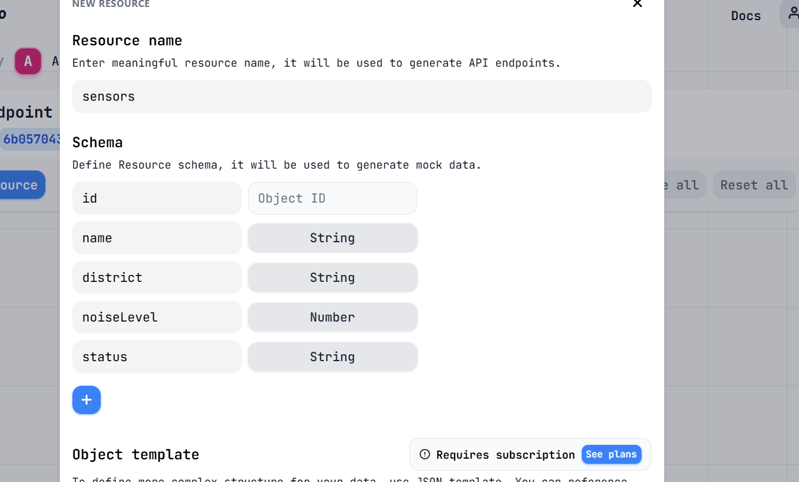
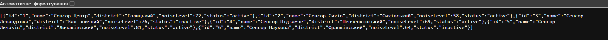
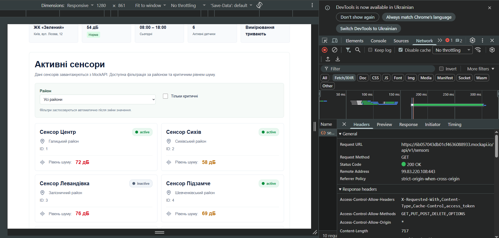
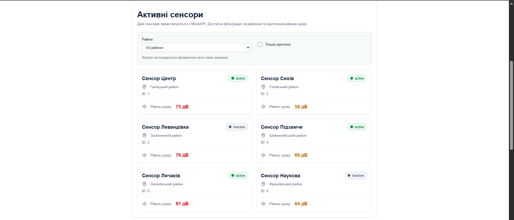

# Звіт з лабораторної роботи №7

**Тема:** Завантаження даних з публічного API та відображення на сторінці

## 1. Мета роботи

Навчитися отримувати дані з публічного REST API за допомогою `fetch()`, перевіряти HTTP-відповідь, перетворювати JSON у масив JavaScript та відображати отримані дані у DOM. Закріпити використання `async/await`, обробку помилок через `try/catch` та перевірку запитів у DevTools → Network.

## 2. Завдання

- Продовжити проєкт «Акустична варта» з попередньої лабораторної роботи.
- Створити тестовий API у MockAPI та ресурс `sensors`.
- Заповнити ресурс шістьма сенсорами з різними районами, рівнями шуму та станами.
- Завантажувати дані через HTTP GET замість готового масиву в JavaScript.
- Перевіряти `response.ok` та `response.status`.
- Читати JSON через `response.json()` і створювати картки сенсорів.
- Обробити помилку завантаження та перевірити запит у Network.
- Перевірити оновлення сторінки після зміни даних у MockAPI.

## 3. Створення та заповнення MockAPI

У MockAPI створено проєкт із префіксом `/api/v1` та ресурсом `sensors`. Для ресурсу визначено такі поля:

| Поле | Тип | Призначення |
| --- | --- | --- |
| `id` | Object ID | Ідентифікатор запису |
| `name` | String | Назва сенсора |
| `district` | String | Район Львова |
| `noiseLevel` | Number | Рівень шуму в децибелах |
| `status` | String | Стан сенсора: `active` або `inactive` |

Структура ресурсу sensors у MockAPI

*Рисунок 1 — Налаштування полів ресурсу sensors.*

Endpoint для отримання сенсорів:

```text
https://6b057043db01cf4636088933.mockapi.io/api/v1/sensors
```

Через вікно Data додано шість записів:

| ID | Назва | Район | Початковий рівень шуму | Стан |
| --- | --- | --- | --- | --- |
| 1 | Сенсор Центр | Галицький | 72 дБ | active |
| 2 | Сенсор Сихів | Сихівський | 58 дБ | active |
| 3 | Сенсор Левандівка | Залізничний | 76 дБ | inactive |
| 4 | Сенсор Підзамче | Шевченківський | 69 дБ | active |
| 5 | Сенсор Личаків | Личаківський | 81 дБ | active |
| 6 | Сенсор Наукова | Франківський | 64 дБ | inactive |

Для перевірки адресу endpoint відкрито безпосередньо у браузері. У відповіді відображено JSON-масив із шістьма об’єктами.

JSON-відповідь API з шістьма сенсорами

*Рисунок 2 — JSON-відповідь ресурсу sensors у браузері.*

## 4. Структура проєкту

| Файл | Призначення |
| --- | --- |
| `index.html` | Наявна сторінка та контейнер сенсорів |
| `js/config.js` | Адреса ресурсу MockAPI |
| `js/app.js` | Завантаження, перевірка даних, відображення та фільтрація |
| `js/models/NoiseSensor.js` | Наявні навчальні пороги шуму `NOISE_LIMITS` |
| `scss/_active-sensors.scss` | Стилі карток, станів сенсорів та повідомлень |
| `css/main.css` | Готові стилі для браузера |
| `mockapi-data.json` | Приклад даних для заповнення MockAPI |

Файл `mockapi-data.json` не використовується сторінкою як джерело даних. Сенсори завантажуються лише з API. Початковий масив у коді застосунку порожній:

```js
let sensors = [];
```

Скрипт підключений як ES-модуль:

```html
<script type="module" src="./js/app.js"></script>
```

Сторінка запускається через локальний HTTP-сервер.

## 5. Реалізація

### 5.1. Контейнер карток та повідомлень

У секції з попередньої роботи використано контейнер з ідентифікатором `sensors-list`. Перед ним розміщено елемент для повідомлень про завантаження та помилки:

```html
<p id="sensors-message" class="sensors-message" role="status"></p>

<div id="sensors-list"
     class="sensor-list"
     aria-live="polite"
     aria-relevant="additions removals"></div>
```

JavaScript отримує посилання на ці елементи:

```js
const sensorList = document.querySelector('#sensors-list');
const loadMessage = document.querySelector('#sensors-message');
```

### 5.2. Налаштування адреси API

У файлі `js/config.js` адресу збережено в константу:

```js
export const API_URL =
  'https://6b057043db01cf4636088933.mockapi.io/api/v1/sensors';
```

У `js/app.js` її імпортовано:

```js
import { API_URL } from './config.js';
```

### 5.3. Завантаження та перевірка відповіді

Для завантаження даних реалізовано асинхронну функцію `loadSensors()`. Основна частина запиту:

```js
const response = await fetch(API_URL);

console.log('GET sensors — HTTP-статус:', response.status);

if (!response.ok) {
  throw new Error(`HTTP error: ${response.status}`);
}

const data = await response.json();
```

Метод `fetch()` без явного зазначення іншого методу виконує GET-запит. Перший `await` очікує отримання HTTP-відповіді. Змінна `response` містить об’єкт `Response`, а не масив сенсорів.

Властивість `response.ok` дорівнює `true` для HTTP-статусів 200–299. Якщо відповідь неуспішна, створюється помилка з її числовим статусом.

Другий `await` очікує читання тіла відповіді та перетворення JSON у JavaScript-дані.

Після отримання перевіряється, що `data` є масивом і кожен запис містить рядкові `id`, `name`, `district`, числове `noiseLevel` та стан `active` або `inactive`.

Після перевірки масив передається до логіки відображення:

```js
sensors = data;

console.log('Сенсори з API:', sensors);

applyFilters();
```

Функція `applyFilters()` збережена з попередньої роботи. Вона передає відібрані дані у `renderSensors()`. За початкових значень фільтрів відображаються всі записи.

### 5.4. Відображення карток

Функція `renderSensors()` отримує готовий масив і не містить мережевих запитів:

```js
function renderSensors(sensorArray) {
  sensorList.replaceChildren();

  sensorArray.forEach(sensor => {
    sensorList.append(createSensorCard(sensor));
  });
}
```

Функція `createSensorCard(sensor)` створює окремий `article`. На картці відображаються назва, ID, район, рівень шуму та стан.

Текст задається через `textContent` або текстові аргументи `append()`.

Приклади заповнення полів:

```js
title.textContent = sensor.name;
badge.textContent = sensor.status;
location.textContent = `ID: ${sensor.id}`;
value.textContent = `${sensor.noiseLevel} дБ`;
```

Стани `active` та `inactive` надходять з API й показують стан пристрою. Вони відокремлені від категорій рівня шуму `normal`, `warning`, `critical`, які використовуються для кольору значення та фільтра «Тільки критичні».

### 5.5. Обробка помилок

Запит виконується всередині `try/catch`. При помилці колекція очищується, у Console виводиться її опис, а на сторінці з’являється повідомлення:

```js
catch (error) {
  sensors = [];

  console.error('Не вдалося завантажити сенсори:', error);

  loadMessage.textContent = API_URL
    ? 'Не вдалося завантажити дані. Перевірте підключення та адресу API.'
    : 'Потрібно вказати адресу MockAPI у файлі js/config.js.';
}
```

Перед запитом попередні картки видаляються, фільтри блокуються та виводиться текст «Завантаження сенсорів…».

Після успішної відповіді фільтри знову стають доступними. Для порожнього масиву показується повідомлення «У API поки немає сенсорів».

## 6. Перевірка та результати

### 6.1. Успішне отримання даних

Після запуску сторінки відобразилися всі шість карток. Назви, райони, рівні шуму та стани відповідають даним у MockAPI.

У DevTools → Network вибрано запит `sensors`. На вкладці Headers підтверджено адресу ресурсу, метод GET та статус 200 OK.

Успішний GET-запит до MockAPI у Network

*Рисунок 3 — Перевірка GET-запиту до ресурсу sensors зі статусом 200 OK.*

Під час повторного запиту також спостерігався статус 304 Not Modified, пов’язаний із перевіркою кешованої відповіді браузером. Для фіксації повної відповіді 200 у DevTools увімкнено Disable cache та перезавантажено сторінку.

### 6.2. Оновлення даних у MockAPI

У ресурсі sensors для запису «Сенсор Центр» змінено `noiseLevel` із 72 на 75.

Після збереження в MockAPI та перезавантаження сторінки картка показала 75 дБ. Код із даними сенсорів на сторінці при цьому не змінювався.

Сторінка після зміни рівня шуму в MockAPI

*Рисунок 4 — Оновлений рівень шуму сенсора «Центр»: 75 дБ замість 72 дБ.*

### 6.3. Помилка завантаження

Для перевірки обробки помилки адресу в `js/config.js` тимчасово змінено на неіснуючий ресурс `sensors-error-test`.

Після перезавантаження сама сторінка залишилася доступною, картки не відобразилися, а в секції з’явилося повідомлення про неможливість завантажити дані.

Повідомлення про помилку завантаження сенсорів

*Рисунок 5 — Відображення повідомлення при помилці запиту до API.*

Для звичайної роботи використовується правильний endpoint `/api/v1/sensors`.

### 6.4. Підсумок перевірок

| Перевірка | Результат |
| --- | --- |
| Відкриття endpoint у браузері | Відображено JSON-масив із шістьма записами |
| Завантаження сенсорів сторінкою | Відображено шість карток із полями API |
| Запит у Network | Метод GET, статус 200 OK |
| Зміна даних на сервері | Після перезавантаження показано 75 дБ замість 72 дБ |
| Запит до неіснуючого ресурсу | Показано повідомлення про помилку |

## 7. Відповіді на контрольні запитання

**1. Що таке API?**

API — інтерфейс взаємодії програм. У цій роботі він дозволяє сторінці отримувати дані сенсорів із сервера MockAPI.

**2. Що таке endpoint?**

Це конкретна адреса API для роботи з певним ресурсом. У проєкті endpoint `/api/v1/sensors` використовується для отримання списку сенсорів.

**3. Для чого використовується HTTP GET?**

Для отримання даних із сервера. У роботі GET повертає масив записів ресурсу sensors.

**4. Що повертає fetch()?**

Promise, який у разі отримання HTTP-відповіді виконується з об’єктом `Response`. Мережева помилка відхиляє Promise.

HTTP-статус 404 або 500 сам по собі не спричиняє відхилення, тому перевіряється `response.ok`.

**5. Що знаходиться у змінній response після await fetch()?**

Об’єкт `Response` із HTTP-статусом, заголовками та тілом відповіді. Це ще не готовий масив сенсорів.

**6. Для чого використовується response.json()?**

Для асинхронного читання тіла відповіді та перетворення JSON у JavaScript-значення, у цій роботі — масив об’єктів.

**7. Чому в типовому GET-запиті використовуються два await?**

Перший очікує HTTP-відповідь, а другий — читання її тіла та перетворення JSON у дані JavaScript.

**8. Що означає response.ok?**

Це булева ознака успішного HTTP-статусу. Значення `true` відповідає діапазону 200–299, а `false` — статусам поза ним.

**9. Де у DevTools можна побачити HTTP-запит?**

На вкладці Network. Фільтр Fetch/XHR дозволяє знайти API-запит, а вкладки Headers, Preview та Response показують його параметри й відповідь.

**10. Для чого потрібен try/catch?**

Для перехоплення помилок під час виконання коду та очікування асинхронних операцій. У роботі він дозволяє вивести пояснення в Console і зрозуміле повідомлення на сторінці замість необробленої помилки.

## 8. Висновок

У лабораторній роботі проєкт «Акустична варта» підключено до тестового REST API MockAPI. Реалізовано GET-запит через `fetch()`, перевірку HTTP-відповіді, читання JSON та відображення отриманого масиву у DOM. Завантаження даних відокремлено від створення карток.

Перевірено отримання шести сенсорів, статус 200 OK у Network, оновлення картки після зміни даних у MockAPI та показ повідомлення при неправильній адресі ресурсу. Закріплено роботу з `async/await`, об’єктом `Response` та конструкцією `try/catch`.