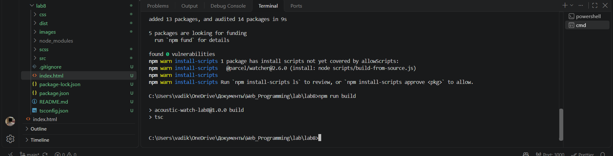
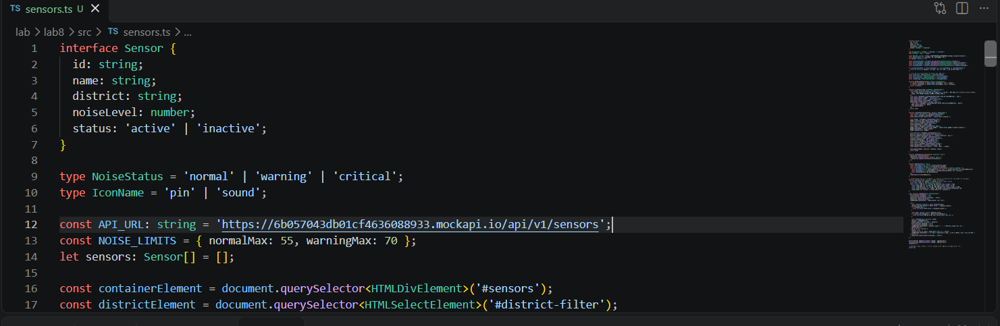
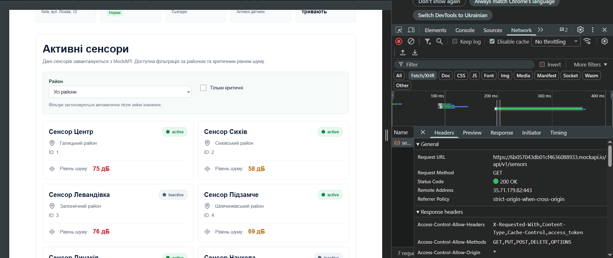

# Звіт з лабораторної роботи №8

**Дисципліна:** Веб-програмування  
**Тема:** Використання TypeScript для завантаження та відображення даних сенсорів  
**Виконав:** Рекунов Вадим Валерійович  
**Група:** КН-41

## Мета роботи

Перенести логіку завантаження та відображення сенсорів проєкту «Акустична варта» на TypeScript. Описати структуру даних, типізувати функції та роботу з DOM, налаштувати компіляцію в JavaScript і перевірити взаємодію з MockAPI.

## Хід роботи

### 1. Підготовка проєкту

За основу використано сайт із попередньої лабораторної роботи. Збережено оформлення сторінки, картки сенсорів і фільтрацію за районом та критичним рівнем шуму.

Вихідний код TypeScript розміщено у `src/sensors.ts`, а результат компіляції — у `dist/sensors.js`.

Встановлення залежностей і компіляцію виконано з каталогу `lab/lab8`:

```bash
npm install
npm run build
```

Скрипт `build` запускає компілятор `tsc`. Компіляція завершилася без помилок.

Успішна компіляція TypeScript

*Рисунок 1 — Виконання npm run build без помилок.*

### 2. Налаштування компілятора

У файлі `tsconfig.json` задано такі параметри:

```json
{
  "compilerOptions": {
    "target": "ES2020",
    "module": "ES2020",
    "moduleResolution": "bundler",
    "lib": ["ES2020", "DOM"],
    "strict": true,
    "noEmitOnError": true,
    "rootDir": "./src",
    "outDir": "./dist"
  },
  "include": ["src/**/*.ts"]
}
```

Параметр `strict` вмикає сувору перевірку типів, а `noEmitOnError` забороняє створення вихідних файлів за наявності помилок компіляції. Каталоги `src` і `dist` відокремлюють вихідний код від скомпільованого.

### 3. Опис структури сенсора

Для даних із MockAPI створено інтерфейс:

```typescript
interface Sensor {
  id: string;
  name: string;
  district: string;
  noiseLevel: number;
  status: 'active' | 'inactive';
}

let sensors: Sensor[] = [];
```

Поле `noiseLevel` містить числовий рівень шуму, а `status` допускає лише два значення: `active` та `inactive`.

Інтерфейс Sensor і типізований масив

*Рисунок 2 — Опис інтерфейсу Sensor, масиву Sensor[] та типізованих посилань на DOM.*

### 4. Типізація роботи з DOM і функцій

Для отримання контейнера використано типізований виклик:

```typescript
const containerElement =
  document.querySelector<HTMLDivElement>('#sensors');
```

Перед використанням контейнера та елементів фільтрації перевіряється, чи знайдено їх у документі. Це дозволяє врахувати можливе значення `null`.

Основні функції мають такі типи параметрів і результатів:

- `loadSensors(): Promise<void>` — асинхронне завантаження даних.
- `renderSensors(sensorArray: Sensor[]): void` — відображення масиву сенсорів.

Функція відображення приймає лише масив об’єктів типу `Sensor` і не повертає значення.

### 5. Завантаження даних із MockAPI

Використано ресурс із лабораторної роботи №7:

[MockAPI — sensors](https://6b057043db01cf4636088933.mockapi.io/api/v1/sensors)

У `loadSensors()` виконується GET-запит через `fetch()`. Після перевірки `response.ok` відповідь перетворюється з JSON на дані типу `unknown`.

Далі перевіряється, що отримано масив і кожен його елемент відповідає структурі сенсора. Лише після цього дані використовуються як `Sensor[]`.

Інтерфейс TypeScript забезпечує перевірку під час компіляції. Для перевірки фактичної відповіді API під час виконання додатково реалізовано функцію `isSensor(value: unknown): value is Sensor`.

Після завантаження застосовуються поточні фільтри й викликається `renderSensors()`. Помилки запиту або некоректні дані обробляються у `catch` з виведенням повідомлення на сторінці.

### 6. Підключення JavaScript і перевірка в браузері

У HTML підключено скомпільований модуль:

```html
<script type="module" src="./dist/sensors.js"></script>
```

Сторінку відкрито через Live Server. Картки сенсорів відображають назву, район, ідентифікатор, стан і рівень шуму.

У вкладці Network зафіксовано GET-запит до ресурсу `sensors` зі статусом `200 OK`.

Картки сенсорів і успішний запит до MockAPI

*Рисунок 3 — Відображення даних із MockAPI та HTTP-статус 200 OK.*

## Результати

| Перевірка | Результат |
| --- | --- |
| Інтерфейс Sensor | Описано поля та допустимі значення status |
| Типізація даних і функцій | Використано Sensor[], Promise<void> та void |
| Робота з DOM | Задано типи елементів і перевірки на null |
| Компіляція | npm run build виконано без помилок |
| Завантаження з MockAPI | GET sensors — 200 OK |
| Відображення | Дані сенсорів показано у картках |

## Висновок

Під час лабораторної роботи логіку сенсорів проєкту «Акустична варта» перенесено на TypeScript. Створено інтерфейс Sensor, типізовано масиви, функції та DOM-елементи, налаштовано сувору перевірку типів і компіляцію в JavaScript. У браузері підтверджено завантаження даних із MockAPI та відображення карток сенсорів.