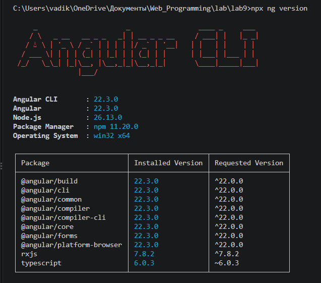
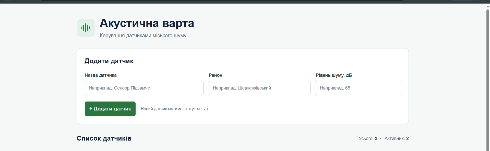
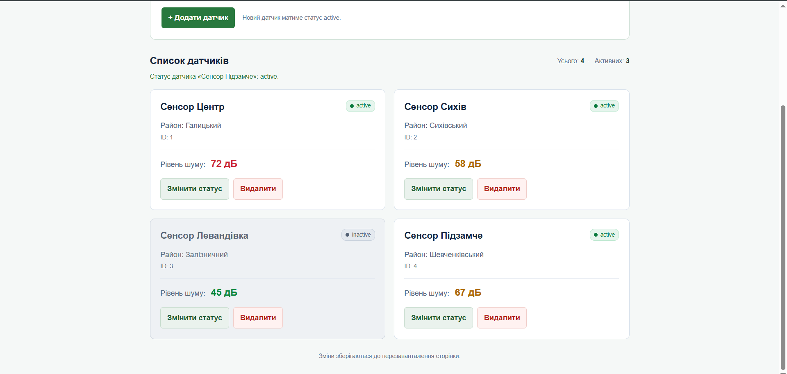
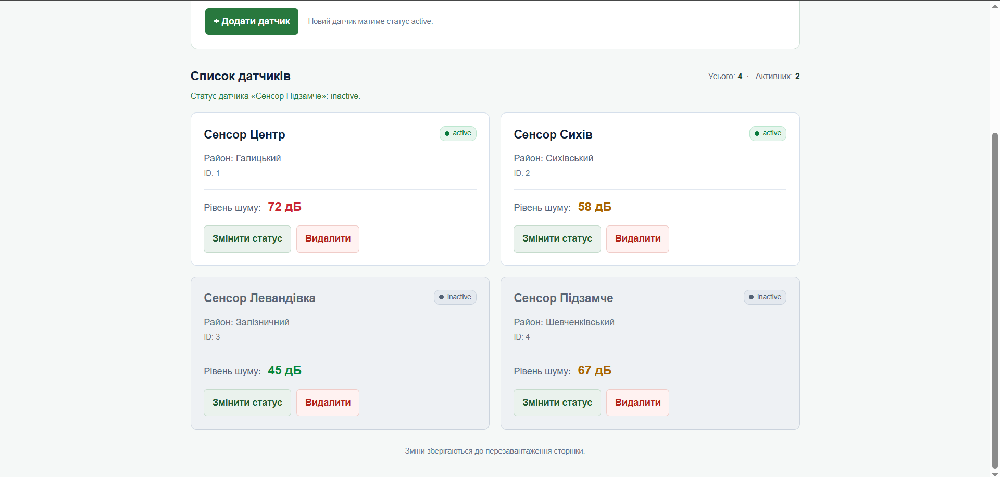
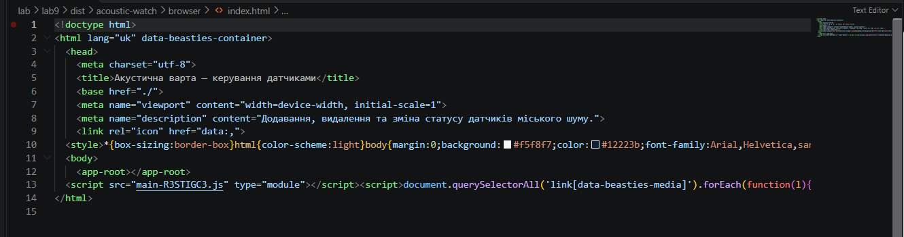
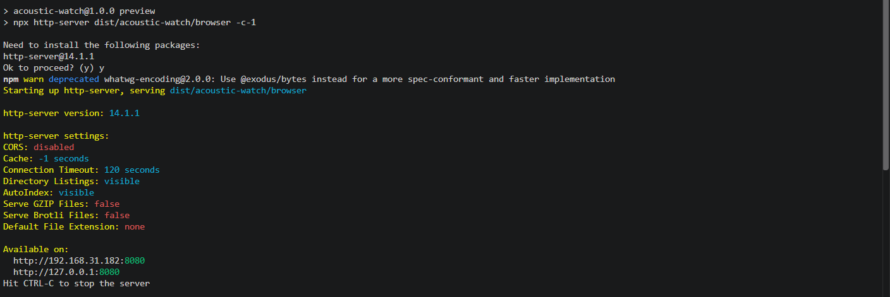
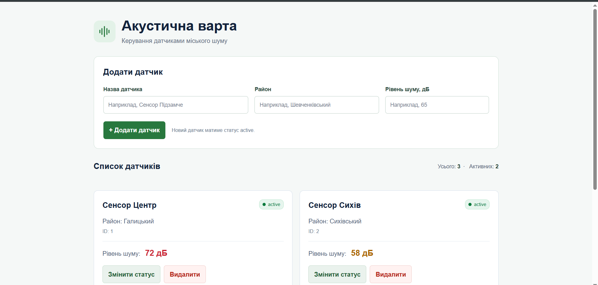

# Звіт з лабораторної роботи №9

**Дисципліна:** Веб-програмування  
**Тема:** Створення простого Angular-застосунку («Todo list»)  

## Мета роботи

Навчитися створювати standalone-застосунок Angular, працювати з компонентом, шаблоном і формою, відображати список датчиків, реалізувати додавання, видалення та перемикання статусу. Виконати production build і опублікувати застосунок на GitHub Pages.

## Хід роботи

### 1. Підготовка середовища

Проєкт «Акустична варта» розміщено в папці `lab/lab9` наявного репозиторію. Встановлено залежності та перевірено версії інструментів:

```bash
npm install
npx ng version
```

Використано Angular CLI 22.3.0, Angular 22.3.0, Node.js 26.13.0, npm 11.20.0 та TypeScript 6.0.3.

Версії Angular CLI та залежностей   

*Рисунок 1 — Перевірка середовища командою npx ng version.*

### 2. Структура застосунку

Застосунок містить один основний standalone-компонент. Окремий AppModule, маршрутизація, SSR і backend не використовуються.

| Файл | Призначення |
| --- | --- |
| `src/app/sensor.ts` | Модель датчика |
| `src/app/app.ts` | Дані та методи керування списком |
| `src/app/app.html` | Форма і шаблон карток |
| `src/app/app.css` | Стилі компонента |
| `src/app/app.config.ts` | Конфігурація застосунку |
| `src/main.ts` | Запуск через bootstrapApplication |
| `angular.json` | Налаштування сервера розробки та збірки |

Для роботи з двостороннім зв’язуванням `[(ngModel)]` до компонента підключено `FormsModule`.

### 3. Модель і початкові дані

У файлі `sensor.ts` описано інтерфейс:

```typescript
export interface Sensor {
  id: number;
  name: string;
  district: string;
  noiseLevel: number;
  status: 'active' | 'inactive';
}
```

У компоненті створено масив `Sensor[]` із трьох датчиків:

| Датчик | Район | Рівень шуму | Статус |
| --- | --- | --- | --- |
| Сенсор Центр | Галицький | 72 дБ | active |
| Сенсор Сихів | Сихівський | 58 дБ | active |
| Сенсор Левандівка | Залізничний | 45 дБ | inactive |

Дані зберігаються лише в пам’яті компонента. Після перезавантаження сторінки відновлюється початковий список. Запити до MockAPI у цій роботі не виконуються.

### 4. Локальний запуск

Для запуску сервера розробки виконано:

```bash
npm start
```

Команда запускає `ng serve`. Застосунок відкрито за адресою `http://localhost:4200/`.


Початковий вигляд застосунку

*Рисунок 2 — Форма додавання та початковий список датчиків.*

### 5. Відображення списку

Для побудови карток використано цикл `@for`:

```html
@for (sensor of sensors; track sensor.id) {
  <article class="sensor-card"
    [class.inactive]="sensor.status === 'inactive'">
    <h3>{{ sensor.name }}</h3>
    <p>Район: {{ sensor.district }}</p>
    <p>Рівень шуму: {{ sensor.noiseLevel }} дБ</p>
    <p>Статус: {{ sensor.status }}</p>
  </article>
}
```

Наведено фрагмент шаблону карток. Інтерполяція підставляє значення полів у HTML. Вираз `track sensor.id` дозволяє Angular відстежувати елементи за їхніми ідентифікаторами. Для порожнього списку передбачено блок `@empty`.

### 6. Додавання датчика

Форма містить поля назви, району та рівня шуму. Через `[(ngModel)]` вони зв’язані зі змінними компонента. Подія `(ngSubmit)` викликає метод `addSensor()`.

Перед додаванням перевіряються непорожні назва й район, а також скінченне невід’ємне числове значення рівня шуму. Новому датчику призначаються унікальний у поточному списку числовий ідентифікатор і статус `active`. Після додавання поля очищуються.

Під час перевірки додано «Сенсор Підзамче»: Шевченківський район, 67 дБ. Кількість датчиків збільшилася до чотирьох.

Доданий датчик зі статусом active

*Рисунок 3 — Сенсор Підзамче у списку датчиків.*

### 7. Перемикання статусу та видалення

Кнопка «Змінити статус» викликає `toggleStatus(id)`. Метод знаходить датчик і змінює `active` на `inactive` або навпаки. Неактивна картка має сіре оформлення.

Після зміни статусу «Сенсор Підзамче» на `inactive` кількість активних датчиків зменшилася з трьох до двох.
Датчик зі зміненим статусом inactive

*Рисунок 4 — Перемикання статусу та оновлення лічильника активних датчиків.*

Видалення реалізовано методом `deleteSensor(id)`: за допомогою `filter()` створюється масив без датчика з переданим ідентифікатором. Кнопка «Видалити» передає цьому методу ID відповідної картки.

### 8. Production build

Для створення готових статичних файлів виконано:

```bash
npm run build
```

Скрипт запускає `ng build`. Збірка завершилася успішно, результат розміщено в `dist/acoustic-watch/browser/`.

У згенерованому `index.html` містяться контейнер `<app-root>`, підключення скомпільованого JavaScript і `<base href="./">`. Відносний базовий шлях дозволяє розміщувати застосунок у підпапці сайту.

Згенерований index.html у папці dist

*Рисунок 5 — Файл dist/acoustic-watch/browser/index.html після збірки.*

Production-версію перевірено через локальний HTTP-сервер:

```bash
npm run preview
```

Команда запускає `http-server` для папки збірки. Сторінку відкрито за адресою `http://127.0.0.1:8080/`.

Production-версія через локальний HTTP-сервер

*Рисунок 6 — Робота готової збірки через HTTP.*

### 9. Публікація на GitHub Pages

Готову статичну збірку розміщено в наявному репозиторії разом із вихідним кодом лабораторної. Залежності з папки `node_modules` до репозиторію не додаються.

Адреса застосунку:

[Акустична варта — лабораторна робота №9](https://vrekunov2023.github.io/Web_Programming/lab/lab9/dist/acoustic-watch/browser/)

Застосунок на GitHub Pages

*Рисунок 7 — Сторінка застосунку після публікації на GitHub Pages.*

## Відповіді на контрольні запитання

**1. Що таке Angular?**  
Angular — фреймворк для створення вебзастосунків на TypeScript. Інтерфейс будується з компонентів, які поєднують логіку, шаблон і стилі.

**2. Для чого потрібен Angular CLI?**  
Angular CLI — інструмент командного рядка для створення проєктів, генерування файлів, запуску сервера розробки та збірки застосунків.

**3. Що робить команда ng new?**  
Створює новий Angular-проєкт із початковими файлами, конфігурацією та залежностями.

**4. Для чого використовується ng serve?**  
Запускає локальний сервер розробки, відстежує зміни у вихідному коді та оновлює застосунок під час роботи.

**5. Що таке компонент Angular?**  
Компонент — частина інтерфейсу, описана TypeScript-класом, HTML-шаблоном і стилями. Декоратор `@Component` задає її налаштування.

**6. Що робить @for у шаблоні?**  
Повторює блок шаблону для кожного елемента колекції. У цій роботі створює картку для кожного датчика.

**7. Для чого потрібен track sensor.id?**  
Задає ідентифікатор елемента, за яким Angular зіставляє дані з картками та оновлює DOM після змін у списку.

**8. Чим ng serve відрізняється від ng build?**  
`ng serve` запускає сервер для розробки. `ng build` створює файли застосунку на диску; за замовчуванням використовується production-конфігурація.

**9. Для чого створюється папка dist?**  
У ній зберігається результат збірки: HTML, CSS, JavaScript та інші ресурси, які можна розмістити на вебсервері або GitHub Pages.

## Висновок

Створено standalone-застосунок Angular для керування датчиками міського шуму. Реалізовано форму з двостороннім зв’язуванням, відображення списку через `@for`, додавання, видалення та перемикання статусу датчиків. Виконано production build, перевірено готову збірку через локальний HTTP-сервер і опубліковано застосунок на GitHub Pages.